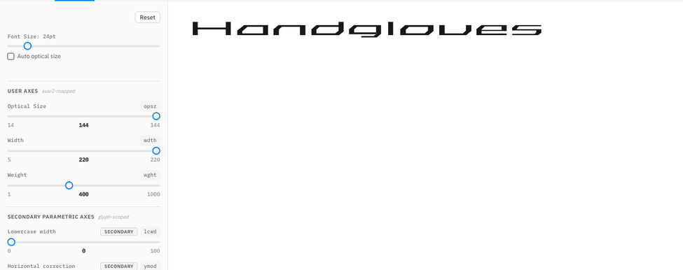
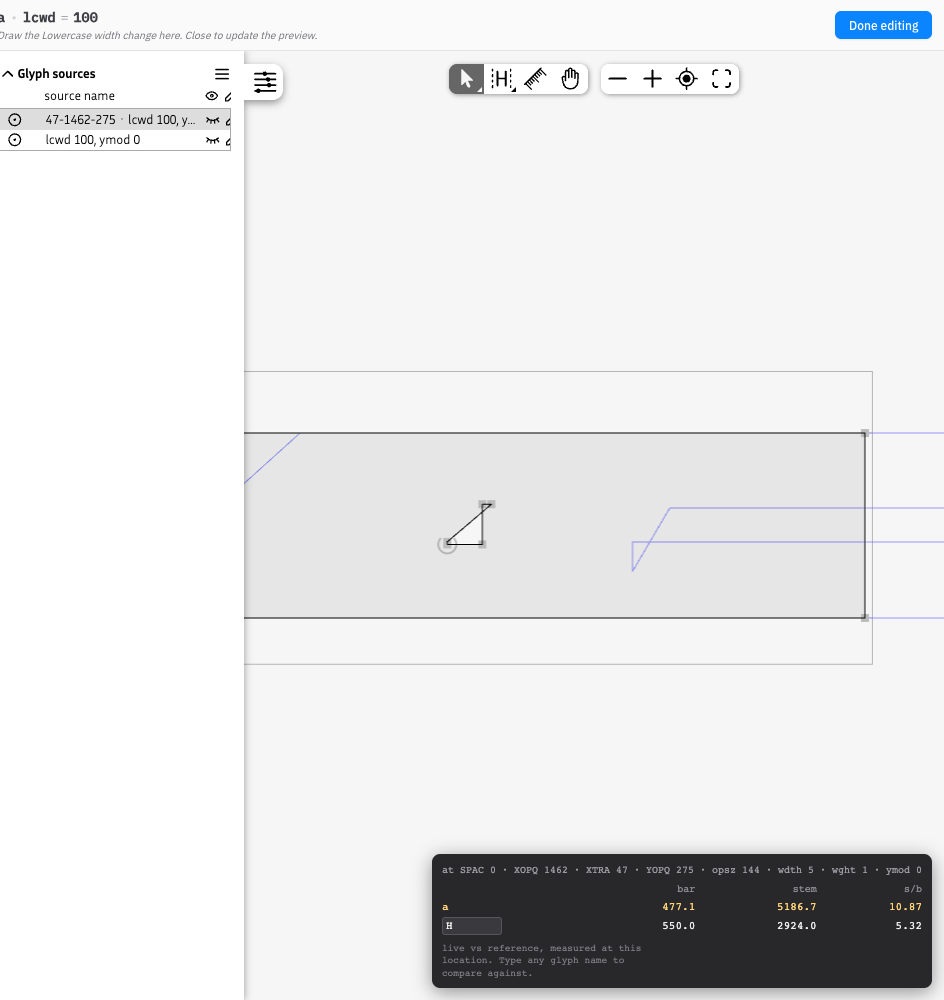
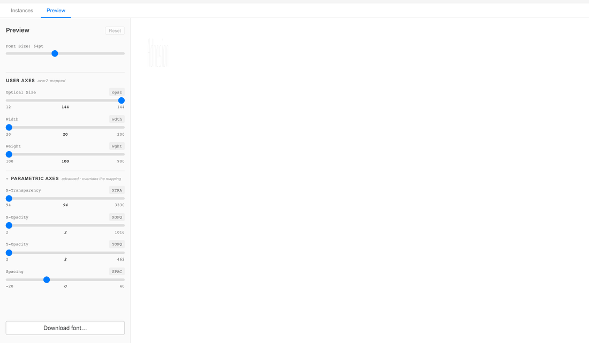
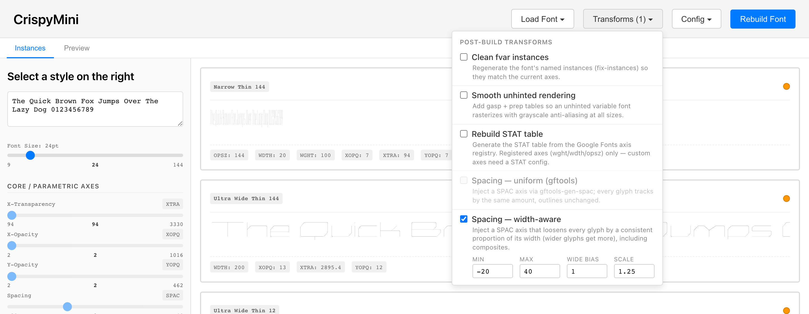

# avar2-studio

Visual authoring and preview tool for avar2 variable fonts.

For type designers working in parametric designspaces (XOPQ / YOPQ /
XTRA, …) who want to expose familiar axes (`wght`, `wdth`, `opsz`, …)
to end users. Author named instances at parametric coordinates;
avar2-studio builds the avar2 table that makes a user's `wght=400`
slider land on the point you chose.

Point it at a `.glyphs` or `.designspace` file and it opens a
browser-based editor on the **actual built font**. Declare
**secondary parametric axes** that deform only chosen glyphs, chain
optional **build transforms** onto every build, grade and space styles,
and — with [Fontra](https://github.com/fontra/fontra) installed
alongside — draw those glyphs' brace layers in an embedded editor.


## Try it in the browser

The [hosted demo](https://agyeiagyeiagyei.github.io/avar2-studio/) runs
the whole studio in your browser, nothing to install. It opens on the
bundled Crispy Mini project; **Load Font ▾ → Examples** also has Roboto
Delta Mini. Both are live projects: edit instances and mappings, declare
secondary axes, grade styles, change transform parameters, rebuild —
compiled in the browser by [fontc](https://github.com/googlefonts/fontc)
built to WebAssembly (a 7 MB download, fetched once). Your work persists
in the browser between visits until you choose **Forget this project**.

To work on your own font, use **Load Font ▾ → Upload .glyphs or project
.zip…** (a file picker; there is no drag-and-drop). Loose files can be a
`.glyphs` with its `-avar.csv` and `axis-metadata.json` beside it. The
other studio files — `-control.json`, `-transforms.json`, `-grade.json`
— travel only inside a project `.zip` (zip the folder your source sits
in), or come in through **Config ▾ → Import configuration…**.

The outline editor works in the browser too: the demo embeds the
[fontra-embed](https://github.com/agyeiagyeiagyei/fontra-embed) bundle
(Fontra's client as a separate GPL sub-project), and drawings stay
source-level in your studio data. What the browser cannot do, compared
with the installed app:

- write anything back to your source file — get your work out with
  **Config ▾ → Download workspace (.zip)…** or **Export configuration…**
- recompile a `.designspace` project: fontc-wasm cannot read UFOs from a
  filesystem, so those load from the built font inside their zip, and
  edits that need a rebuild are unavailable (Roboto Delta Mini included)
- space styles with Kinetikern (the tab needs the native engine)

## Install

There are two ways in, and they are not interchangeable.

**The studio (GUI).** Install from PyPI. The package carries the built
frontend, and `fontc` and `gftools` come with it as dependencies:

```bash
pipx install avar2-studio
avar2-studio path/to/MyFont.glyphs       # or .designspace
```

The first build runs on launch; open `http://localhost:5001`. Launching
with no source opens a **Load Font** picker for your own file.

**Headless (CI, scripts).** Installing from git gives you `build` and
`doctor` but **no frontend bundle** — the server answers 503 until you
build one yourself (see [docs/DEVELOPMENT.md](docs/DEVELOPMENT.md)):

```bash
pipx install git+https://github.com/agyeiagyeiagyei/avar2-studio
avar2-studio build path/to/MyFont.glyphs --out fonts/
```

**Optional: the embedded outline editor.** Fontra is not a dependency.
To draw brace layers inside the studio, add it to the same environment:

```bash
pipx inject avar2-studio git+https://github.com/fontra/fontra.git git+https://github.com/fontra/fontra-glyphs.git
```

**Optional: native accelerators.** The width-aware spacing transform
prefers a native injector and the Kinetikern tab needs the Kinetikern2
engine; both are Rust builds from a checkout (`cargo build --release` in
`wasm/fontc-web` and in `native/kinetikern2`), or point `AVAR2_SPAC_INJECT`
/ `AVAR2_KK2_DYLIB` at builds kept elsewhere. Without them spacing falls
back to a slower pure-Python path and the Kinetikern tab reports that the
engine is not built.

`avar2-studio doctor` reports what is present. Compiling with fontmake
instead of fontc (`--no-fontc`) needs fontmake installed as well.

**In Glyphs.** The package also carries a set of Glyphs 3 plugins: a
**Window → avar2 Studio** menu that opens the studio on the font you are
editing, and six parametric design tools (Corner Radii, Instance Delta,
Multi-Source Edit, Metrics Parity, Slant Master, Width Matcher).
Link them into Glyphs once, from the same install:

```bash
avar2-studio install-glyphs-plugins    # then restart Glyphs
```

[src/avar2_studio/glyphs/README.md](src/avar2_studio/glyphs/README.md)
documents the menu and each tool.

## Your files

Everything the studio authors lives next to your source, named after
the source's stem, so it can be committed with it
(formats: [docs/SIDECARS.md](docs/SIDECARS.md)):

| File | Commit? | Holds | Written by |
|---|---|---|---|
| `MyFont.glyphs` / `.designspace` | yes, it's yours | the source | you; the studio only on an explicit row action (`Save to source file`, `Remove from source file`, delete with source) |
| `MyFont-avar.csv` | yes | named instances and avar2 mappings (schema below) | the Instances tab; backed up before every rewrite |
| `MyFont-control.json` | yes | secondary parametric axes: applicable glyphs, layer locations, drawn outlines, per-style values | the SECONDARY PARAMETRIC AXES panel and the outline editor |
| `MyFont-transforms.json` | yes | which transforms are on, with their parameters | the Transforms menu |
| `MyFont-grade.json` | yes | grade on/off, default %, intensity, headroom clamp, per-style anchors (`.glyphs` sources only) | the Grade toggle and the `G` badges |
| `MyFont-kinetikern.json` | yes | per-style spacing corrections: the looseness each style was spaced at and how far each glyph's sides moved | the Kinetikern tab |
| `.avar2-studio/` | no, gitignore it | `build/` (the preview font), `shadow/`, `exports/`, `jobs/`, `config.yaml`, `backups/` (the last 20 of each sidecar), `axis-metadata.json` (display names and ranges of the axes you declare), `instance-renames.json` | the studio |

Studio axis authoring never edits your source: once studio-authored
brace layers exist, builds compile from a shadow copy in
`.avar2-studio/shadow/`, regenerated from your source every time you
save it in Glyphs.

### The mappings CSV

`MyFont-avar.csv` is the authoring source of truth: one row per named
instance, one column per axis. Crispy's, abridged:

```
Instance Name,XTRA,XOPQ,YOPQ,WGHT,WDTH,OPSZ
Def,663.1,202.5,121.8,400.0,100.0,48.0
Width Matcher Preview,47.0,1462.0,275.0,,,
```

- `Instance Name` is required, spelled exactly like that.
- A column whose name matches one of the source's master-spanned axes
  (`XTRA`, `XOPQ`, `YOPQ` here) is a **parametric axis**; every other
  column — `WGHT`, `WDTH`, `OPSZ`, `CONTRAST`, … — is a **user axis**
  (they become the registered tags, `wght` and so on).
- A row with user-axis values is an avar2 mapping: those user
  coordinates land on the parametric point in the row. A row with
  empty user cells, like the second one, is a plain parametric instance.
- A blank parametric cell is an error; a blank user cell is skipped for
  that axis. Rows that resolve to the same input location are
  deduplicated (the first wins), and `opsz` drops out of the mapping
  when every row shares one value.
- `SPAC` is the one special column: a per-style spacing coordinate the
  studio adds the first time you set one. Secondary-axis values are
  never columns; they live in `MyFont-control.json`.

## Features

### Instances & avar2 mappings

The **Instances** tab is the authoring surface: create named instances
and tune each one's parametric coordinates with the sidebar sliders;
each row renders live in the built font. Give an instance user-axis
coordinates under **AVAR2 MAPPINGS** and it becomes an avar2 mapping.
[docs/guides/authoring-instances.md](docs/guides/authoring-instances.md)
walks the full workflow.


- **CORE / PARAMETRIC AXES** deform every glyph in the font;
  **SECONDARY PARAMETRIC AXES** deform only chosen glyphs (`scoped`
  and `studio` badges; next section).
- A row's `SRC` badge marks an instance that exists in the source. The
  coloured dot's flyout saves a row in the studio, promotes it into
  the source, or removes it from there.
- **Mapping lint** flags rows the build would silently drop: grid
  points no axis reaches, and rows sitting at the default location
  (discarded, skewing every sibling row).

### Secondary parametric axes

Sometimes the global axes are *almost* right. Crispy's `wght` runs to
1000, and the heavy end gains contrast that sits wrong on the
lowercase — so Crispy declares `LCWD`, an axis that renders each
lowercase glyph there *as if at* a lighter XOPQ, while the capitals
stay put. A secondary parametric axis is a slider that deforms only
the glyphs you give it, built from brace layers pinned anywhere in the
designspace.

- **+ Add** to declare one: name it, pick its glyphs, pin the
  locations. New locations can land on every applicable glyph in one
  submit.
- **Correction layers** compute an outline *as if at* another
  parametric point, re-derived on every build; the studio warns when a
  correction is unpinned and would leak along an axis.
- Draw the other layers in the **embedded Fontra editor**, against
  reference glyphs, with live measurements in the HUD.
- Everything lands in `MyFont-control.json`, drawings included, so your
  studio data is a complete backup.






Deep-dive:
[docs/guides/secondary-parametric-axes.md](docs/guides/secondary-parametric-axes.md).

### Preview & export

The **Preview** tab drives the built font the way an end user's app
would: type directly in the specimen, move any fvar axis. Moving a
user axis reflects the computed avar2 mapping onto the parametric
sliders.



A note on rendering engines, as of September 2026: the exported font's
avar2 works wherever avar2 is implemented, and HarfBuzz-based stacks
and recent WebKit/CoreText apply it. Chrome does not apply avar2 in its
text pipeline yet, so in the in-browser preview the glyphs follow the
fvar axes while the sliders show the computed mapping. What ships is
the real table either way.

**Download font…** opens an export dialog: pick **TTF or WOFF2** (the
sizes are shown before you download — WOFF2 is compressed in the
background after every build), mark axes as hidden in the exported
font, or **set a default** — pick an axis combination and the export
interpolates a master there and makes it the font's origin (the
source file is never touched).


### Grade

Darken or lighten a style **without changing its advance widths**.
Turn **Grade** on in the Transforms menu, then click a style's **`G`**
badge to set its %; grades interpolate between the styles you set, so
you grade a few anchors, not every style. **Intensity** scales every
grade at once, and the headroom clamp keeps a grade from bleeding into
counters that cannot open. [docs/guides/grade.md](docs/guides/grade.md).

### Kinetikern

Space a style with [Kinetikern2](https://github.com/bghryct/kinetikern2)'s
engine (Mirko Velimirovic, MIT): Pass 1 of its kinetic equilibrium over
glyph triplets, run on the built font at that style. The **Kinetikern**
tab lists every style; pick one, set the looseness (0 is the engine's
calibrated middle), compare before and after over the shared sample
text, then **Apply** (stores the result as per-glyph side deltas in
`MyFont-kinetikern.json` and rebuilds), **Revert**, or **Apply to all…**
at one looseness so the family stays consistent. Corrections are baked
into every build as small variation tuples that move spacing only —
outlines never move — and they also ride exports. Kerning is not part of
this pass. [docs/guides/kinetikern.md](docs/guides/kinetikern.md).

### Build transforms

Optional steps that run on every build, saved to
`MyFont-transforms.json`:

- **Spacing — uniform (gftools)** / **Spacing — width-aware** — a
  `SPAC` axis; sidebearings and advances only, outlines never change.
- **Clean fvar instances**, **Rebuild STAT table**, **Smooth unhinted
  rendering** (`gftools`).
- **Round corners** — every corner of every master and brace gains a
  round whose radius follows that layer's stroke and width, on a `ROND`
  axis (0 = sharp) with a rounding percentage per style (**R badge**).
- **Slant** — build-time italics on a `slnt` axis, each master sheared
  at its own angle, with a slant percentage per style (**S badge**);
  styles named *Italic* or *Slanted* keep their own full slant.

Write your own: drop a `.py` subclassing `Transform` into
`~/.avar2-studio/transforms/` and it appears in the menu on the next
launch. [docs/guides/transforms.md](docs/guides/transforms.md).



### Configuration export / import

The **Config** menu moves a whole studio configuration between sources
or machines as a single file — secondary parametric axes with their
drawings, avar2 mappings, transforms, grade. Import validates first and
is all-or-nothing: a report lists anything the loaded source is
missing, and nothing is applied until you confirm. A bundle whose
mappings section is empty leaves your mappings as they are. **Download
workspace (.zip)…** packs the source, every studio file and the current
build into one archive that opens here or in the browser demo.

### Glyphs plugins

Installed with `avar2-studio install-glyphs-plugins`, **Window → avar2
Studio** in Glyphs 3 opens the studio on the font being edited (reusing
a studio already serving it), stops it, and toggles the design tools
that ship alongside: **Corner Radii** (rounded-corner audit and
scaling), **Instance Delta** (a master or instance drawn behind the
edited glyph, with the advance delta), **Multi-Source Edit** (node drags
propagated across masters), **Metrics Parity** (masters sharing the
metric-driving axis values must share metrics), **Slant Master** (an
italic master sheared from a master or instance, width-matched to a
reference) and **Width Matcher** (a new master width-matched to a
reference). Each is described in
[src/avar2_studio/glyphs/README.md](src/avar2_studio/glyphs/README.md).

## Command line

Server: `avar2-studio [SOURCE] [options]`

| Option | Default | What it does |
|---|---|---|
| `SOURCE` (or `--glyphs PATH`) | none | the `.glyphs` or `.designspace` to open; without it the studio starts with a Load Font picker |
| `--port` | `5001` | port to serve on (5000 is taken by AirPlay on macOS) |
| `--host` | `127.0.0.1` | interface to bind |
| `--no-fontc` | off | compile with fontmake instead of fontc |
| `--debug` | off | Flask debug mode with auto-reload (can interrupt an in-flight build) |

The mappings file is always `<stem>-avar.csv` beside the source and
builds always go to `.avar2-studio/build/` beside it; the old `--csv`
and `--build-dir` options exit with an error.

`avar2-studio build SOURCE --out DIR` runs one headless build — the
same pipeline the studio runs on load (sidecars, control-axis shadow,
grade layers, transforms, avar2) with no server, watcher or editor —
and copies the font into `DIR`. Exit 0 prints the font's path; 1 means
the build, the avar2 mapping, the grade or a source transform failed (a
plain fallback font is not a pass); 2 means the source did not load.
Crispy's CI is the reference use.

`avar2-studio doctor` checks Python (3.10 or newer), fontc,
gftools-builder, glyphsLib, the frontend bundle, Fontra (optional), the
native `spac-inject` injector and the Kinetikern2 engine (optional), a
second install shadowing this one, and stale processes holding the
studio's ports.

`avar2-studio install-glyphs-plugins` symlinks the bundled Glyphs 3
plugins into `~/Library/Application Support/Glyphs 3/Plugins/` and
records this Python in `~/.avar2-studio/glyphs-plugin.json` for the
menu's *Open in avar2 Studio*; `--uninstall` reverses both.

Runtime environment variables:

| Variable | Effect |
|---|---|
| `AVAR2_STUDIO_DEBUG=1` | Flask debug + reloader (same as `--debug`) |
| `AVAR2_STUDIO_DEMO=1` | Show the landing overlay (for a shared host) |
| `AVAR2_STUDIO_GFTOOLS_BUILDER=1` | Build through an external `gftools builder` instead of in-process |
| `AVAR2_RELOCATE_BUILD_DEFAULT=0` | Turn off the build-time default-origin relocation (on by default) |
| `AVAR2_SPAC_INJECT` | Path to the native `spac-inject` binary |
| `AVAR2_KK2_DYLIB` | Path to the Kinetikern2 engine library |

The complete table — including the variables the build sets itself and
the frontend and test-suite ones — is in
[docs/DEVELOPMENT.md](docs/DEVELOPMENT.md#environment-variables).

## Documentation

[docs/README.md](docs/README.md) is the map. In short:

- [docs/ARCHITECTURE.md](docs/ARCHITECTURE.md) — processes, module map,
  the source-path model, the pipeline order and its physics, the API,
  desktop-vs-browser parity, the Fontra contracts
- [docs/DEVELOPMENT.md](docs/DEVELOPMENT.md) — set up a checkout, run
  the studio, build the frontend, run the tests, CI and releases,
  branch policy
- [docs/SIDECARS.md](docs/SIDECARS.md) — every file the studio writes
- [docs/guides/](docs/README.md) — instances and mappings, secondary
  parametric axes, grade, Kinetikern, transforms
- [docs/decisions/](docs/decisions/README.md) — why things are the way
  they are, with the measurements
- [examples/README.md](examples/README.md) — the bundled example projects

## Roadmap

- [x] Outline editing in the browser demo (Fontra as a separate GPL
  sub-project — [fontra-embed](https://github.com/agyeiagyeiagyei/fontra-embed)
  — embedded and driven over `postMessage`)
- [ ] Push-to-source sync (write studio-declared axes from the sidecar
  into the `.glyphs` on request)
- [ ] Grade-master comparison panel (parked on the `grade-comparison`
  branch)

## License

Apache-2.0. See [LICENSE](LICENSE).
