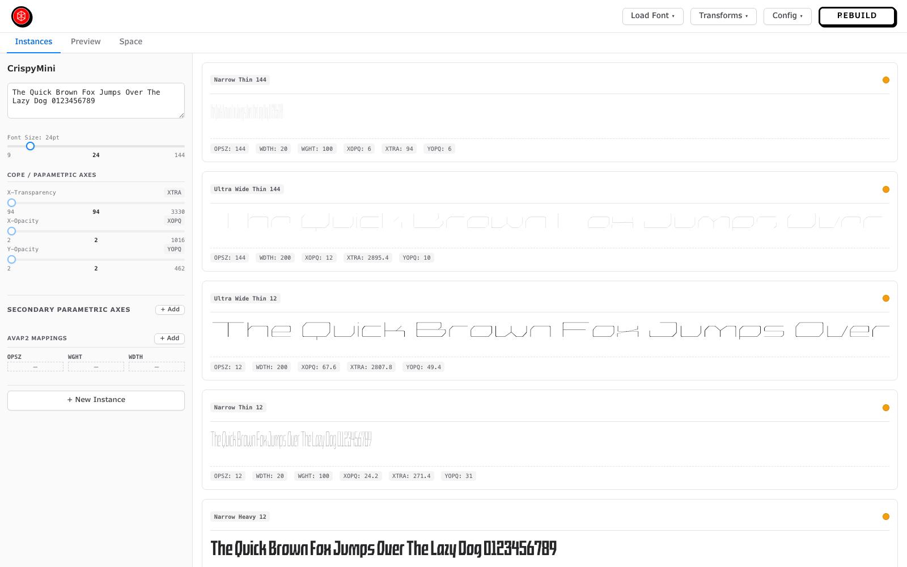
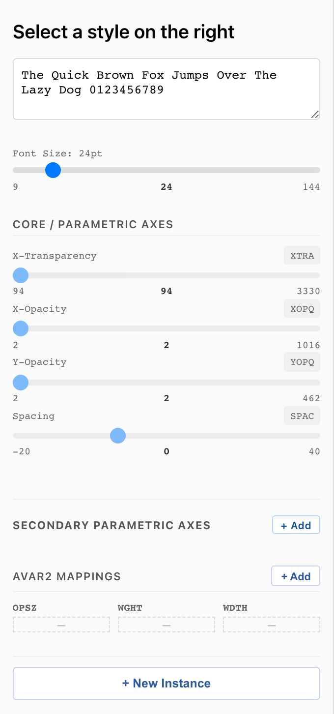
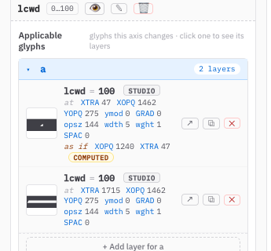
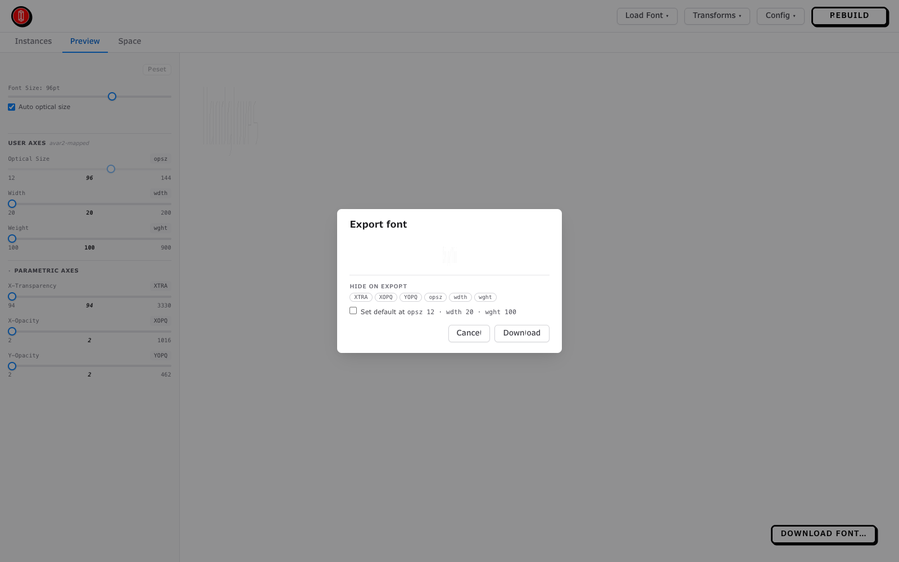

# avar2-studio

Visual authoring and preview tool for avar2 variable fonts.

For designers working in parametric designspaces (XOPQ / YOPQ / XTRA, …) who
want to expose familiar axes (`wght`, `wdth`, `opsz`, …) to end users. Author
named instances at parametric coordinates; avar2-studio builds the avar2 table
that makes a user's `wght=400` slider land on the point you chose.

Point it at a `.glyphs` or `.designspace` file and it opens a browser-based
editor on the **actual built font**: declare **secondary parametric axes** that
deform only chosen glyphs, chain **build transforms** onto every build, grade and
space styles, and — with [Fontra](https://github.com/fontra/fontra) installed
alongside — draw those glyphs' brace layers in an embedded editor.



## Try it in the browser

The [hosted demo](https://agyeiagyeiagyei.github.io/avar2-studio/) runs the studio
in your browser, nothing to install. It opens on Crispy Mini; **Load Font ▾ →
Examples** also has Roboto Delta Mini. Both are live: edit instances and mappings,
declare secondary axes, grade styles, rebuild — compiled in the browser by
[fontc](https://github.com/googlefonts/fontc) as WebAssembly. Work persists until
you choose **Forget this project**.

Your own font comes in through **Load Font ▾ → Upload .glyphs or project .zip…**.
The browser cannot write back to your source (export with **Config ▾ → Download
workspace (.zip)…**), recompile a `.designspace` project (fontc-wasm cannot read
UFOs from a filesystem), or space styles with Kinetikern.

## Install

**There is no PyPI release yet** — `0.1.0` is published by a `v*` tag that has not
been cut, so install from git. The Python side installs, but the frontend bundle
is a build output rather than a committed file, so the GUI needs one frontend
build and the server answers 503 until it has one:

```bash
git clone https://github.com/agyeiagyeiagyei/avar2-studio && cd avar2-studio
pipx install .
cd frontend && npm install && npm run build \
  && rsync -a --delete build/ ../src/avar2_studio/static/
avar2-studio path/to/MyFont.glyphs      # or .designspace → http://localhost:5001
```

Launching with no source opens a **Load Font** picker. `fontc` and `gftools` come
with the package. `build` and `doctor` need no frontend at all — flags, the
committed build config, exit codes and the CI recipe are in
[docs/CLI.md](docs/CLI.md).

Optional: **Fontra** for the embedded outline editor (`pipx inject avar2-studio
git+https://github.com/fontra/fontra.git git+https://github.com/fontra/fontra-glyphs.git`),
and the **native accelerators** (`spac-inject`, `libkinetikern2`) — they ship in
the platform wheels, and from a checkout you build them with `cargo build
--release` in `wasm/fontc-web` and `native/kinetikern2` ([decision
0015](docs/decisions/0015-native-accelerators-ship-in-platform-wheels.md)).
Without them spacing falls back to a slower pure-Python path and Kinetikern
reports the engine is not built. `avar2-studio doctor` says what is present;
`--strict` exits non-zero when something is missing.

**In Glyphs.** `avar2-studio install-glyphs-plugins` links the bundled plugins
into Glyphs 3: a **Window → avar2 Studio** menu that opens the studio on the font
you are editing, plus six design tools (Corner Radii, Instance Delta, Multi-Source
Edit, Metrics Parity, Slant Master, Width Matcher). Restart Glyphs afterwards;
[the plugin README](src/avar2_studio/glyphs/README.md) documents each.

## Your files

Everything the studio authors lives beside your source, named after its stem, so
it can be committed with it. Your original is never written for studio
authoring: once studio brace layers exist, builds compile from a shadow copy in
`.avar2-studio/shadow/`, regenerated whenever you save in Glyphs.

| File | Commit? | Holds |
|---|---|---|
| `MyFont.glyphs` / `.designspace` | yes, it's yours | the source — touched only on an explicit row action |
| `MyFont-avar.csv` | yes | named instances and avar2 mappings |
| `MyFont-control.json` | yes | secondary parametric axes, their layers and drawings |
| `MyFont-transforms.json` | yes | which transforms are on, with their parameters |
| `MyFont-grade.json` | yes | grade on/off, default %, intensity, headroom clamp, per-style anchors |
| `MyFont-kinetikern.json` | yes | per-style spacing corrections |
| `<stem>-axis-metadata.json` | yes | declared axis defaults and display names — the build exits 2 without it |
| `<stem>-build.json` | optional | reproducible export choices for `avar2-studio build` |
| `.avar2-studio/` | no, gitignore it | build output, shadow, exports, jobs, config, backups |

Every format is specified in [docs/SIDECARS.md](docs/SIDECARS.md).

## Features

**Instances & avar2 mappings.** Named instances tuned with the sidebar sliders,
each rendering live in the built font; user-axis coordinates under **AVAR2
MAPPINGS** turn a row into an avar2 mapping, and **mapping lint** flags rows the
build would silently drop. [Guide](docs/guides/authoring-instances.md).



**Secondary parametric axes.** Sliders that deform only the glyphs you give them,
from brace layers pinned anywhere in the designspace — Crispy's `LCWD` renders
lowercase at the heavy end *as if at* a lighter XOPQ while the capitals stay put.
Correction layers are re-derived on every build; the rest you draw in the
**embedded Fontra editor**. [Guide](docs/guides/secondary-parametric-axes.md).



**Preview & export.** Drive the built font the way an end user's app would, then
**Download font…** as **TTF** or **WOFF2**, flag axes hidden, or **set a default**
so the export rests at a picked style — the source is never touched. **UFO +
designspace (zip)** hands fontmake users the masters plus a designspace 5 with the
mappings; spacing is not in it, and the dialog says so.



**Grade.** Darken or lighten a style **without changing advance widths**: turn
Grade on, click a style's **`G`** badge, and grades interpolate between the styles
you set. [Guide](docs/guides/grade.md).

**Kinetikern.** Space a style with
[Kinetikern2](https://github.com/bghryct/kinetikern2)'s kinetic equilibrium, per
style, with before/after panes and a looseness slider; the result bakes into every
build as spacing-only variation tuples. A family-wide switch turns it off without
losing the work. Kerning is not part of this pass.
[Guide](docs/guides/kinetikern.md).

**Build transforms.** Optional steps on every build: spacing uniform or
width-aware (a `SPAC` axis), clean fvar, rebuild STAT, round corners (`ROND`),
build-time slant (`slnt`) — plus your own `.py` transforms.
[Guide](docs/guides/transforms.md).

**Configuration export / import.** Move a whole configuration between sources or
machines as one file: secondary axes with drawings, mappings, transforms, grade.
Import validates first and applies nothing until you confirm, and **Download
workspace (.zip)…** packs source, studio files and the current build together.

## Command line

`avar2-studio build SOURCE --out DIR` runs the pipeline the app runs on load,
with no server and no watcher: hide axes, re-origin at a resting style, write
WOFF2 or the UFO + designspace zip, reproduce a repo's exports from a committed
`<stem>-build.json`, and `doctor --strict` for CI. Exit codes tell a build
failure from a usage error. All of it is in [docs/CLI.md](docs/CLI.md).

## Documentation

[docs/README.md](docs/README.md) is the map. For designers:
[instances and mappings](docs/guides/authoring-instances.md), [secondary
parametric axes](docs/guides/secondary-parametric-axes.md),
[grade](docs/guides/grade.md), [Kinetikern](docs/guides/kinetikern.md),
[transforms](docs/guides/transforms.md),
[example projects](examples/README.md). Appendices: [command
line](docs/CLI.md), [sidecars](docs/SIDECARS.md),
[architecture](docs/ARCHITECTURE.md), [development](docs/DEVELOPMENT.md),
[decisions](docs/decisions/README.md),
[Glyphs plugins](src/avar2_studio/glyphs/README.md).

## Roadmap

- [x] Outline editing in the browser demo (Fontra as a separate GPL sub-project,
  [fontra-embed](https://github.com/agyeiagyeiagyei/fontra-embed))
- [ ] Push-to-source sync (write studio-declared axes into the `.glyphs` on request)
- [ ] Grade-master comparison panel (parked on the `grade-comparison` branch)

## License

Apache-2.0. See [LICENSE](LICENSE).
