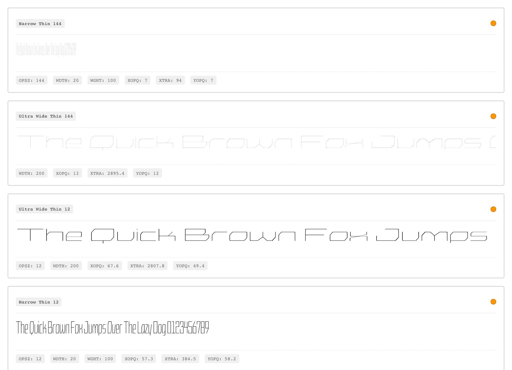
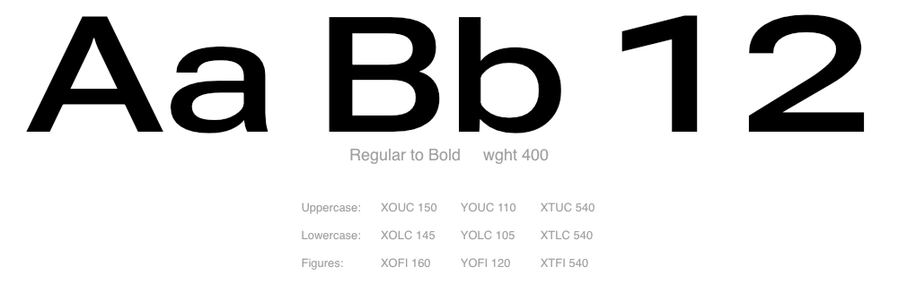

# Authoring instances from parametric axes

avar2-studio works on any source whose designspace is parametric — one whose
masters are elemental letterform components (stroke weight, counter width,
x-height) rather than finished styles. This guide walks the workflow it exists to
support: turning that parametric vocabulary into named stylistic instances, using
the two fonts in [`examples/`](../../examples/) as concrete demonstrations.

Neither font exposes `wght`/`wdth`/`opsz` as gvar axes. In both, the masters
describe elemental glyph components through parametric axes (`XOPQ` thick stroke,
`YOPQ` thin stroke, `XTRA` counter width, …) and the **avar2 table translates the
traditional axes into them** — the user moves familiar `wght`/`wdth`/`opsz` knobs,
and the avar2 layer re-projects those values into the parametric designspace at
render time. Authoring that routing is the studio's job: **the mappings CSV is
where it lives**, one row per named stylistic instance, whose traditional-axis
columns are the user-facing address (`wght=400 wdth=100`) and whose parametric
columns are the coordinates that address maps to.



The split between the two approaches is in **how the parametric axes are laid
out** — how many, and which glyphs each one deforms.

## The unified approach (Crispy)

Crispy ships **three parametric axes** that together describe stroke thickness and
counter width for the whole alphabet:

| Axis | What it does | Range |
|---|---|---|
| `XOPQ` | Vertical-stroke thickness (X opacity) | 2 – 1016 |
| `YOPQ` | Horizontal-stroke thickness (Y opacity) | 2 – 462 |
| `XTRA` | Counter width / horizontal proportions (X transparency) | 94 – 3330 |

One `XOPQ` slider thickens every cap stem, every lowercase stem, every digit
stem — uniformly. Same for `YOPQ` on horizontals and `XTRA` on counters: the
masters were drawn so the same stroke weight applied across `A`, `a` and `1`
produces a balanced result without per-case correction. That evenness is a
deliberate constraint, and it makes authoring economical — three parametric
values per row pin down where in the designspace a style lives.

### Walkthrough: a corner of the space → a named style

The Crispy Mini fixture ships **eight named rows in `CrispyMini-avar.csv`**; the
`.glyphs` source itself declares no instances. The build's compiled origin is the
first master, the thin-condensed corner at `XTRA=94`, `XOPQ=2`, `YOPQ=2` — a
corner, not a screen-ready style. Here is one of the shipped rows:

| Style | `wght` | `wdth` | `opsz` | `XTRA` | `XOPQ` | `YOPQ` |
|---|---|---|---|---|---|---|
| compiled origin | — | — | — | 94 | 2 | 2 |
| Narrow Heavy 144 | 900 | 20 | 144 | 94 | 310.2 | 243 |

The `wght`/`wdth`/`opsz` columns are what end users see, and they become the
registered tags. The parametric columns are where the studio drives the font.
The avar2 mapping bridges them: once the row is in the CSV, the build writes a
table so `wght=900 wdth=20 opsz=144` resolves to
`(XTRA=94, XOPQ=310.2, YOPQ=243)` at render time.

Axis by axis, what the move does:

- `XTRA` stays 94 — counters stay as condensed as the drawing allows at this width.
- `XOPQ` 2 → 310.2 — vertical strokes reach "heavy".
- `YOPQ` 2 → 243 — horizontals follow, lighter than the verticals to hold contrast.

To author your own, use **+ New Instance** in the Instances tab: the modal asks
for the axis values up front, and the row lands in the CSV in this same shape.


## The case-split approach (Roboto Delta)

Roboto Delta Mini ships **nine parametric axes** — the same three concepts, applied
independently per script case across **nineteen sources**:

| | Thick stroke | Thin stroke | Counter width |
|---|---|---|---|
| **Uppercase** | `XOUC` | `YOUC` | `XTUC` |
| **Lowercase** | `XOLC` | `YOLC` | `XTLC` |
| **Figures (digits)** | `XOFI` | `YOFI` | `XTFI` |

The vocabulary is unchanged — every cell is some flavour of X opacity, Y opacity
or X transparency — but each script case gets its own trio. Moving `XOUC`
thickens caps without touching lowercase; moving `XOFI` thickens digits without
touching either. The design admits that the stroke weight which keeps a Bold `A`
clean at 14 pt closes up the counter of a Bold `e`, so it lets the designer push
them at different rates.

Cost: nine parametric values per instance instead of three — more authoring per
row, in exchange for per-case control. The production Roboto Delta goes further,
adding case-scoped height and internal-counter axes; the fixture keeps the demo on
stroke contrast.



## Choosing between them

| | Unified (Crispy) | Case-split (Roboto Delta) |
|---|---|---|
| Parametric axes | 3 | 9 (or more, with case-scoped heights/internal counters) |
| Per-instance authoring | 3 values | 9 values |
| Per-case independence | None — caps and lowercase share stroke weight | Full — each script case is tuned separately |
| Best fit | Display / geometric designs with even tone | Text / system fonts that must read across a wide optical-size range |

Rule of thumb: **case-split is what you need when the font has to work small.**
At display sizes the eye forgives shared stroke weight; at 8–10 pt it does not. If
you can name only one or two places where a Bold `a` should be thinner than a Bold
`A`, try unified first.

## What a couple of instances buys you

Two points define a line, not a designspace. The Crispy production font has **30
authored instances spanning three widths, five weights and two optical sizes**;
Roboto Delta has dozens more. Two rows already give a workable single-axis range;
`Thin` and `Black` extend it, a condensed row puts `wdth` in play, and optical
sizes that prefer thicker thin-strokes at 9 pt put `opsz` in play. Each row is a
few minutes in the studio.

## Hands-on

```bash
avar2-studio examples/crispy-mini/sources/CrispyMini.glyphs
avar2-studio examples/roboto-delta-mini/sources/RobotoDeltaMini.designspace
```

Each fixture's README documents its axis table, coverage and provenance:
[crispy-mini](../../examples/crispy-mini/README.md),
[roboto-delta-mini](../../examples/roboto-delta-mini/README.md). The animation
scripts sit beside the GIFs.
